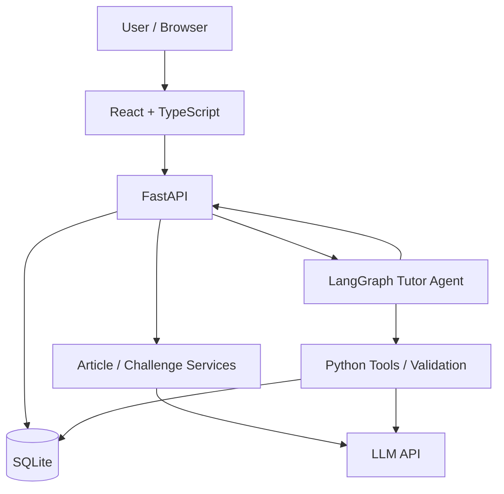
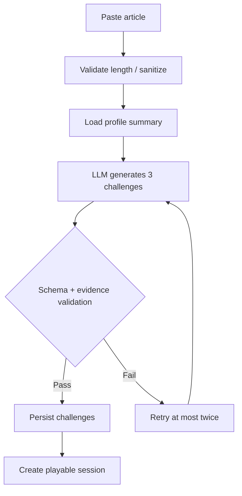
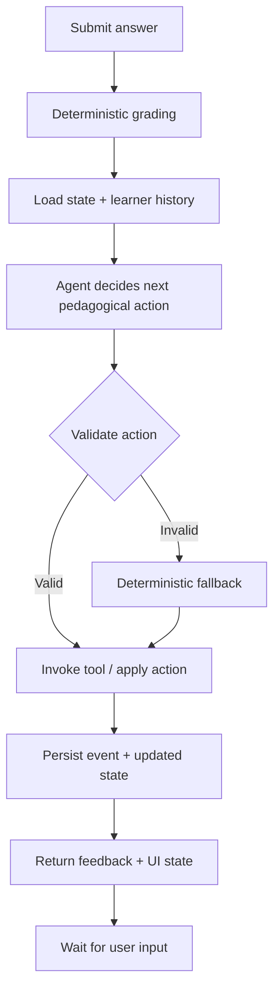

# Reading Quest — AI-Powered Adaptive English Reading Game

> **项目需求与分步开发指南（Codex 版）**  
> 状态：待开发 / Living document  
> 文档语言：中文（代码、接口、技术术语使用英文）  
> 首要目标：**做出一个可以玩、可以验证 Agent 决策、可以诚实写进 AI Engineer 简历的个人项目。**

---

## 0. 写给 Codex：协作约定（请先读）

你是这个项目的 **Senior AI Engineer + Pair Programming Mentor**，不是一次性生成全部代码的自动交付机器人。

**协作规则：**

1. **分步开发。** 一次只推进一个最小、可验证的开发步骤。先讲目标、方案、将修改的文件、预期结果，再动手。每完成一步，给出本地验证方法和验收标准，等待我明确说“继续”。
2. **边做边教。** 解释为什么需要每一层、每个重要设计取舍；对关键代码说明数据如何流动。优先让我理解 Agent、Tool Calling、State Management、Evaluation，而不是只得到能运行的代码。
3. **坚持 MVP 范围。** 不要自行增加登录、支付、移动端、排行榜、RAG、向量数据库、多 Agent、语音、硬件、复杂动画或自动抓取新闻；如果认为必要，先解释原因并征得同意。
4. **先小后大。** 初始版本允许使用静态样例文章、mock 题目和模拟 Agent；先做完整闭环，再接入真实 LLM 和 LangGraph。
5. **透明执行。** 在安装依赖、运行外部命令、重构大量文件、访问网络、部署或执行可能破坏数据的操作前说明意图与影响，并征求许可。不要打印或提交 API Key，不能把密钥放进前端。
6. **严格验证。** 每步完成后运行相关检查（在获得许可并可运行的情况下）；没有实际运行的测试不要声称通过；任何无法验证的内容注明原因。
7. **保护 Agent 的真实性。** 不能只写 Prompt 然后称为 Agent。必须有可观察的状态、至少一个可调用工具、根据用户表现选择下一步动作的决策逻辑、执行轨迹，以及自动化测试。
8. **回答用中文。** 代码命名与简历措辞用英文。尽量保持代码可读、模块化，不为“看起来高级”过度设计。
9. **进度记录。** 每完成一小步，更新文档末尾的开发记录 / TODO（或在仓库中维护 `docs/progress.md`），简要注明已完成、遇到的问题、下一步。不能擅自勾选尚未验证的验收项。

**收到本文件后的第一条回复：**

- 用简短中文复述你理解的目标与严格的 MVP 边界；
- 检查当前仓库结构（如有权限）；
- 只建议 **Step 0.1：确定仓库结构与本地运行方式**，说明准备执行的命令及原因；
- **不要立刻生成整个项目，也不要自行进入下一个步骤**。

---

## 1. 项目概览

### 1.1 项目名称

**Reading Quest**  
*An AI-Powered Adaptive English Reading Game*

### 1.2 一句话定位

把用户提供的英文文章自动转化为小型阅读闯关游戏；一个有状态的 **Adaptive Tutor Agent** 根据用户回答、历史薄弱点和当前挑战，自主选择提示、简化练习、重试或推进关卡，并保存学习进度。

### 1.3 为什么做它

- 用户喜欢英文技术文章、科普、新闻、故事和经典博客，不想只依赖当日新闻。
- 传统阅读工具通常只是查词、翻译、显示答案，缺少短时可完成的游戏目标与有效反馈。
- 本项目希望让人每天愿意读 **一篇有趣文章、完成三个小挑战**，并能看到自己的成长。
- 求职定位：展示 **AI Application Engineering + Agent Orchestration + Tool Calling + Persistent State + Evaluation + Full-stack Engineering**。

### 1.4 不做的事情

这不是新闻侦探推理游戏、不是新闻真实性核查平台、不是纯聊天机器人，也不是一开始就做 Duolingo 级别的完整教学系统。

### 1.5 目标用户

第一阶段仅支持 **一名本地用户**，以中高级（大致 B1–C1）英文学习者为主要测试对象；英语水平标签只是产品配置与粗略难度估计，**不宣称是正式 CEFR 测试结果**。

---

## 2. 核心使用流程（MVP 用户旅程）

1. 用户打开 Web App，粘贴一篇约 **300–800 词**的英文文章，可选标题和主题（技术、商业、科普、故事等）。
2. 系统显示文章，生成 **3 个核心阅读挑战**，内容必须来自该文章：
   - **Main Idea**：理解核心观点（单选）；
   - **Vocabulary in Context**：根据上下文理解一个实用表达（单选）；
   - **Sentence Puzzle**：理解句子逻辑/搭配（第一版使用选词填空，而非自由拖拽）。
3. 用户回答。后端确定性判分，Tutor Agent 结合当前状态和历史表现，选择一个允许的下一步动作：
   - `GIVE_HINT`：给提示但不直接泄露答案；
   - `SIMPLIFY`：生成更简单的相关补救题/例句；
   - `RETRY`：允许再次作答；
   - `NEXT_CHALLENGE`：推进下一关；
   - `COMPLETE`：结束本次闯关。
4. 前端显示即时反馈、XP、进度。用户可继续挑战或退出，刷新后可以恢复进行中的 Session。
5. 最后一关完成后，生成简短学习总结：掌握了什么、哪里需要复习；保存学习事件。
6. 下次用户开始新文章时，Agent 能读取上次记录，至少在**一处具体的题目选择/提示策略**上体现差异。

### 游戏感的最低要求

- 三关进度条、通过/未通过反馈、简单 XP、完成动画或徽章；不需要复杂游戏世界。
- 每关最多两次常规作答；再次失败时提供简化练习或答案解释并允许继续，**不能无限循环**。
- 错误不重罚；鼓励完成阅读，而不是让 AI 随机打高分。
- 主文始终可查看，不要为了“游戏化”把全文藏起来。
- XP 由后端确定性计算，不由 LLM 任意决定；重复刷同一题不得无限刷 XP。

---

## 3. MVP 功能边界

| 模块 | V1 必须完成 | 后续可考虑（不属于 V1） |
|---|---|---|
| 输入 | 粘贴文章全文；可选标题 | URL 导入、RSS、每日自动推荐 |
| 文章 | 展示全文、基本字数检查 | 划词解释、双语对照、阅读器标注 |
| 游戏 | 3 种类型、每篇 3 道核心题 | 卡牌、小镇、闯关地图、动画系统 |
| Agent | 动态选择提示/简化/继续；状态保存 | 多 Agent、复杂课程规划 |
| 个性化 | 保存学习事件；下一次体现一次调整 | 复杂知识追踪、间隔复习算法 |
| 进度 | XP、关卡、完成页、历史摘要 | 连续签到、排行榜、社交 |
| 质量 | 题目结构验证、来源证据、基础测试 | 完整教育学效果研究 |
| 用户 | 单人本地模式 | 登录、多租户、支付 |
| 模型 | 一个支持结构化输出的 LLM API | 多模型路由、本地 LLM、性能基准 |

**范围原则：** 如果某功能不能直接提升“完成一篇文章的三关闭环”或“证明 Agent 能力”，优先延期。

---

## 4. Agent 的真正价值（简历核心）

### 4.1 不够充分的方案

`Article → 一次 LLM 生成三道题 → 用户答题 → 显示对错`

这主要是 LLM 应用，不足以充分证明 Agent 能力。

### 4.2 目标方案

`Observe answer → Evaluate deterministically → Load learner/session state → Agent chooses next action → Invoke allowed tool → Update persistent state → Return structured UI response`

**设计原则：**

- **LLM 决定教学策略**（在受限 Action Space 内），例如该不该先提示、还是降低难度；
- **Python 负责可靠执行**（判分、校验、状态转移合法性、XP、持久化、次数限制）；
- **工具有实际行为**（查学习档案、读取文章上下文、生成补救练习、写学习事件），不是在 Prompt 中写几个假工具名；
- **Agent 有可观察执行轨迹**：输入状态、所选动作、工具调用、校验结果、时间/Token（可用时）；
- **可测试**：同一文章下，不同学习表现会导致不同策略；还能对比固定流程 Baseline。

### 4.3 推荐的 Agent State（概念结构）

```python
class TutorState(TypedDict):
    session_id: str
    article_id: str
    current_challenge_id: str
    skill_tag: str
    attempt_count: int
    last_answer_correct: bool | None
    recent_errors: list[str]
    learner_weak_skills: list[str]
    selected_action: str | None
    hint_level: int
    completed: bool
```

状态字段是初版建议，实际实现可按需要精简。**不要在状态中把正确答案发送给前端。**

### 4.4 工具清单

| Tool | 输入 → 输出 | 安全/可靠性 |
|---|---|---|
| `get_learner_profile` | learner/session → weak skills、history summary | 只读 |
| `get_article_context` | article、challenge → 原文相关证据 | 只读；文章是非可信内容 |
| `generate_challenge` | article、type、difficulty → validated question | 结构校验、证据检查 |
| `generate_remedial_challenge` | weak skill、source span → simpler question | 限制数量、不能偷偷换核心答案 |
| `evaluate_answer` | challenge、answer → correctness | **尽量确定性判分** |
| `save_learning_progress` | session、event → persisted record | 后端校验；防重复写入 |

工具可以先实现为 Python 函数，并通过 LangGraph/模型工具调用机制编排。至少演示一条 **由 Agent 决策触发、真实执行并写入 Trace 的工具调用路径**。

### 4.5 Agent 决策限制

Agent 的输出建议使用 Pydantic schema：

```python
class TutorDecision(BaseModel):
    action: Literal[
        "GIVE_HINT", "SIMPLIFY", "RETRY", "NEXT_CHALLENGE", "COMPLETE"
    ]
    reason: str  # concise diagnostic reason, not hidden reasoning
    feedback: str
    target_skill: str | None = None
```

服务端必须二次校验合法性。例如：答对才能按正常流程解锁下一关；达到尝试上限必须给学习反馈；完成所有三关才可 `COMPLETE`；LLM 结果不合法则使用**可解释的确定性 fallback**。

**MVP 不承诺模型真的理解用户的“英语水平”。** 先从答题事件与技能标签建立粗粒度适应策略，后续再评估效果。

---

## 5. 推荐技术方案

| 层 | 技术 | 目的 |
|---|---|---|
| Frontend | React + TypeScript + Vite | 阅读器、游戏 UI、状态展示 |
| Backend | Python + FastAPI | API、输入校验、业务规则 |
| Agent Orchestration | LangGraph | 状态节点、条件分支、工具调用、恢复流程 |
| LLM | 一种支持 JSON/Structured Output 的 API | 文章分析、生成题目、提示与策略决策 |
| Validation | Pydantic | 校验 LLM 输出与 API 数据 |
| Database | SQLite + SQLAlchemy | 文章、问题、Session、学习事件 |
| Tests | Pytest；前端按需 Vitest | 工具、服务、Agent 行为测试 |
| Deployment | 本地运行优先；后续 Docker | 可复现部署 |

### 5.1 不要引入的基础设施

V1 **不需要** RAG、Embeddings、向量数据库、Celery、消息队列、Kubernetes、MCP Server、Multi-Agent。单篇文章能直接放在模型上下文内（须限制长度和成本）。

### 5.2 系统数据流



### 5.3 工程目录建议

```text
reading-quest/
├── frontend/
│   └── src/
│       ├── components/
│       ├── pages/
│       ├── api/
│       └── types/
├── backend/
│   ├── app/
│   │   ├── api/
│   │   ├── agents/         # state, graph, tools, prompts
│   │   ├── services/       # article, challenge, evaluation
│   │   ├── db/
│   │   └── schemas/
│   └── tests/
├── docs/
│   ├── progress.md
│   ├── architecture.md
│   └── evaluation.md
├── .env.example
└── README.md
```

实际文件可以由 Codex 在 Step 0 与用户讨论后渐进创建，不需在第一步一次生成所有空文件。

---

## 6. 数据模型与接口（初始契约）

### 6.1 核心数据库表

| 表 | 关键字段 | 说明 |
|---|---|---|
| `articles` | `id, title, content, topic, created_at` | 第一版只存用户提交的文章 |
| `challenges` | `id, article_id, session_id?, type, prompt, options_json, correct_option_id, source_quote, skill_tag, difficulty` | `session_id` 可用于补救题；正确答案仅后端可读 |
| `sessions` | `id, article_id, current_step, status, xp, state_json, created_at, updated_at` | 支持刷新后恢复 |
| `learning_events` | `id, session_id, challenge_id, skill_tag, answer_correct, attempt_number, agent_action, created_at` | 可统计长期弱项与评估轨迹 |

单用户，不需要 `users` 表。学习档案可以先从 `learning_events` 聚合；如果以后需要更复杂的个性化再单独建表。

### 6.2 API 草案

```http
POST /api/articles                 # 提交文本并创建文章；后续生成题目
POST /api/sessions                 # 开始阅读挑战
GET  /api/sessions/{session_id}    # 获取当前游戏状态（不含答案）
POST /api/sessions/{session_id}/answers
GET  /api/progress                 # 获取基本学习进度
```

建议 `POST /api/sessions/{session_id}/answers` 请求：

```json
{
  "challenge_id": "challenge-123",
  "selected_option_id": "B",
  "request_id": "unique-client-request-id"
}
```

响应示例：

```json
{
  "correct": false,
  "agent_action": "GIVE_HINT",
  "feedback": "Look at the contrast between performance and cost.",
  "retry_allowed": true,
  "xp_awarded": 0,
  "session_completed": false,
  "next_challenge": null
}
```

`request_id` 用于防止重试请求重复计分和重复写学习事件；实现细节可根据第一版进度简化。**答案 key 不应出现在前端请求前的题目 API 响应中。**

### 6.3 题目结构建议

```json
{
  "type": "VOCABULARY",
  "prompt": "What does 'trade-off' mean in this paragraph?",
  "options": [
    {"id": "A", "text": "A technical upgrade"},
    {"id": "B", "text": "A balance between competing goals"},
    {"id": "C", "text": "A type of model training"}
  ],
  "correct_option_id": "B",
  "source_quote": "...trade-off between performance and computational cost.",
  "skill_tag": "vocabulary_in_context",
  "explanation": "The phrase describes balancing competing priorities."
}
```

**生成校验：** 枚举类型合法、选项不重复、正确选项确实存在、支持答案的 `source_quote` 能在文章中匹配（可先进行空白归一化匹配）、解释与引文不矛盾。纯代码验证不足以保证语义正确，应进行人工抽样或独立评估。

---

## 7. LangGraph Workflow

### 7.1 文章准备（更偏确定性工作流）



### 7.2 游戏阶段（Agent 核心）



**注意：** 不要求每次答题都强行调用 LLM。如果确定性行为足够可靠，可直接处理，并在 Trace 中记录原因；至少保留真实的 Agent 决策路径供演示与测试。这样更符合生产系统对成本、时延和可靠性的要求。

---

## 8. Evaluation：证明 Agent 能力，而非只展示 Demo

### 8.1 最小测试集合（建议目标，不是已有成绩）

- **15 篇**经过检查、题材不同的英文样例文章；
- **45 道**对应的生成题目（每篇 3 道）；
- 至少 **6 类 Agent 行为场景**：一次答对、首次答错、连续答错、用户中断/恢复、非法答题请求、跨 Session 弱项复习；
- 对比 **Adaptive Agent vs Fixed Workflow**：同一组模拟回答序列，是否产生不同且合适的教学策略。

### 8.2 指标

| 指标 | 测量方法 |
|---|---|
| `question_validity_rate` | 人工审核题目是否明确、答案及引文是否成立 |
| `agent_action_validity_rate` | 预设场景中动作是否合法、是否符合预期 |
| `workflow_completion_rate` | 测试 Session 是否能正确结束并保存 |
| `adaptation_coverage` | 针对不同学习记录，是否触发可解释的不同策略 |
| `p50/p90_latency` | API/Agent 调用的实际耗时 |
| `token_usage` | LLM Provider 返回的用量（如果可用） |

不要把“Agent 的策略确实发生变化”描述为“英语学习效果明显提升”。真正的学习效果需要真实用户与长期对照测试。

### 8.3 工程质量底线

- Pydantic 校验所有模型输出；限制重试与最大输出长度；
- Prompt Injection：文章内容是**不可信数据**，不能指挥 Agent 调用工具、泄露配置或改变教学规则；
- 不允许 LLM 自行写 SQL 或修改关键业务状态；
- API key 仅在后端环境变量，不写入 Git，不返回给浏览器；
- 失败时提供明确提示、可重试机制、日志；
- 用户粘贴的文章只供本地测试和个人学习，不自动公开或发布受版权保护的全文。

---

## 9. 分阶段开发与验收

> 开发顺序以 **“每一步能实际运行”** 为原则。下面是里程碑，不是要求 Codex 一次全部完成。

### M0 · Project Setup

- [ ] **Step 0.1** 确认开发环境、仓库结构、包管理、启动命令（先讲清楚再执行）。
- [ ] **Step 0.2** 创建最小 React + TypeScript 页面和 FastAPI `/health`。
- [ ] **Step 0.3** 前后端连通，页面能展示服务端返回的数据；写清楚启动说明。

**验收：** 本地能分别启动前后端，浏览器能看到 `/health` 请求成功，README 能复现。

### M1 · Playable Article Game（先不用真实 Agent）

- [ ] **Step 1.1** 用一篇内置样例文章 + 三道手工题做 UI。
- [ ] **Step 1.2** 实现答题、后端判分、XP、进度条、结算页面。
- [ ] **Step 1.3** 接入 SQLite，保存文章、题目、Session；刷新可恢复。
- [ ] **Step 1.4** 接入一个 LLM API；把粘贴文章变成三道结构化题目。
- [ ] **Step 1.5** 增加生成校验、失败处理和基础测试。

**验收：** 用户粘贴文章后，能从头到尾完成三关；题目可验证且答案不泄露；刷新不丢数据。

### M2 · Adaptive Tutor Agent（简历核心）

- [ ] **Step 2.1** 定义 Agent State、有限动作集、合法状态转移。
- [ ] **Step 2.2** 用 LangGraph 实现读取状态 → 决策 → 工具 → 持久化。
- [ ] **Step 2.3** 实现首次错误时给提示、重复错误时简化、答对推进，限制无限重试。
- [ ] **Step 2.4** 记录决策 Trace，加入 6 类场景自动化测试。

**验收：** 同一道题在不同答题情况下走不同路径；Tool 调用与状态变化可见、可测；不发生无界循环。

### M3 · Cross-Session Learning Memory

- [ ] **Step 3.1** 记录技能标签、作答历史、补救效果。
- [ ] **Step 3.2** 汇总 learner profile，影响下一篇的题目难度或补救策略。
- [ ] **Step 3.3** 前端提供简单历史页面或学习总结。

**验收：** 相同新文章在不同已保存学习档案下，至少一种教学决策有明确差异；能解释差异为何发生。

### M4 · Evaluation & Portfolio-ready Release

- [ ] **Step 4.1** 建立 15 篇文章、45 道题的质量审核样本。
- [ ] **Step 4.2** 对比 Adaptive Agent 与 Fixed Workflow；记录真实结果。
- [ ] **Step 4.3** 加入延迟、Token Usage、错误日志；完善测试。
- [ ] **Step 4.4** 完善 README、架构图、Evaluation Report、演示视频；按需 Docker 化。

**验收：** 一位陌生开发者能够按 README 跑起 Demo；仓库有测试说明、限制说明、Agent Trace 和经过核实的评估数据。

---

## 10. 简历用语（完成后再根据事实修改）

**Reading Quest | AI-Powered Adaptive English Learning Agent**  
*Python, FastAPI, LangGraph, React, TypeScript, SQLite, LLM APIs*

- Built a full-stack AI reading application that transforms English articles into interactive, personalized learning challenges using LLMs and structured outputs.
- Developed a stateful learning agent with tool calling, persistent learner memory, and adaptive decision-making to adjust exercises and feedback based on user performance.
- Implemented an evaluation pipeline to validate AI-generated questions, test agent decisions, and monitor task success, latency, and token usage.

**使用条件：** 对应功能和测试确实完成后才能使用；第三条如果没做完整 Evaluation，必须删减。不要杜撰用户数、准确率或性能提升。若有真实测试结果，再在词条中补充有依据的量化数据。

### 面试时要能回答的问题

1. Why an agent instead of a single LLM call or a fixed workflow?
2. Which decisions are made by the LLM, and which are deterministic?
3. How do you manage persistent state and prevent invalid transitions?
4. How do you validate AI-generated questions and prevent hallucinations?
5. How do you evaluate agent behavior against a non-agent baseline?
6. What are the latency, cost, privacy and security trade-offs?

---

## 11. 明确的非目标与后续路线

**不在 MVP：** URL 抓取与每日选文、新闻真实性核查、推理破案剧情、RAG、音频、Stack-chan/硬件、多人系统、复杂小游戏、排行榜、移动 App。

**若完成 MVP 且真的想继续使用，再考虑：**

1. Article Discovery Agent：结合兴趣、难度、历史与公开来源推荐新旧文章；保留原文链接与作者信息。
2. Vocabulary Deck：阅读中自动收集表达并安排轻量复习。
3. Reading Collection：按主题解锁阅读图鉴。
4. 更多游戏玩法：段落排序、预测下文、限时挑战。
5. 更严谨的教学评估：真实用户反馈与长期学习效果。

这些功能要从真实使用反馈中选择，不为了丰富简历堆砌。

---

## 12. 首次交给 Codex 的启动指令（直接复制）

> 我准备开始开发这个项目。请先完整阅读 `Reading_Quest_Project_Spec_for_Codex.md`。把自己当作我的 Pair Programming Mentor，目标是让我理解并能在 AI Engineer 面试中解释每个重要设计。请严格遵守文档第 0 节的分步协作规则，不要一次性实现全部功能。
>
> 现在**只做 Step 0.1**：检查当前仓库和我的本地开发环境，建议最小目录结构、依赖选择及启动方式。先告诉我将创建或修改哪些文件、为什么、有哪些命令需要运行，以及这一步的验收标准。**在我确认之前，不要继续实现 Step 0.2 或后续功能。**

---

## 13. 开发记录模板

在 `docs/progress.md` 中逐步维护：

```md
# Development Log

## Current milestone
M0 / Step 0.1

## Completed and verified
- [ ] ...

## Decisions and rationale
- ...

## How to run / verify
- ...

## Known issues
- ...

## Next smallest step
- ...
```

**项目成功标准：** 不只是生成几道题，而是有一个真正可玩的阅读游戏、一个能解释并验证其教学决策的有状态 Agent，以及足以支持简历描述的真实工程证据。
